

  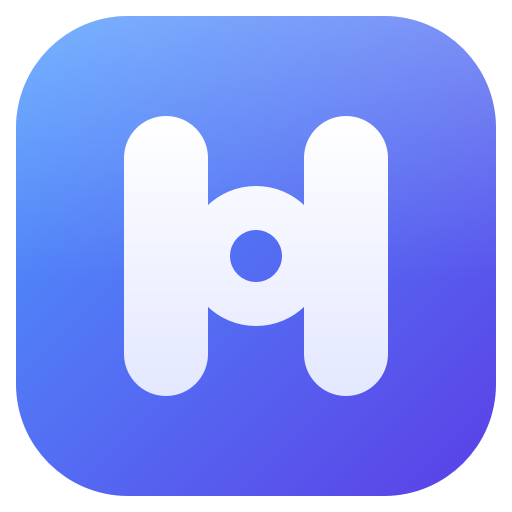

<h1 align="center">Hub</h1>

  <b>All your apps and games, in one place.</b> 
  A fast, good-looking launcher for Windows 10 and 11.

  <a href="https://github.com/AestasDev/HUB-releases/releases/latest"><b>⬇ Download the latest version</b></a>
  &nbsp;·&nbsp;
  <a href="https://discord.gg/bhseMPZqn8"><b>💬 Join the Discord</b></a>
  &nbsp;·&nbsp;
  <a href="README.fr.md">🇫🇷 Français</a>

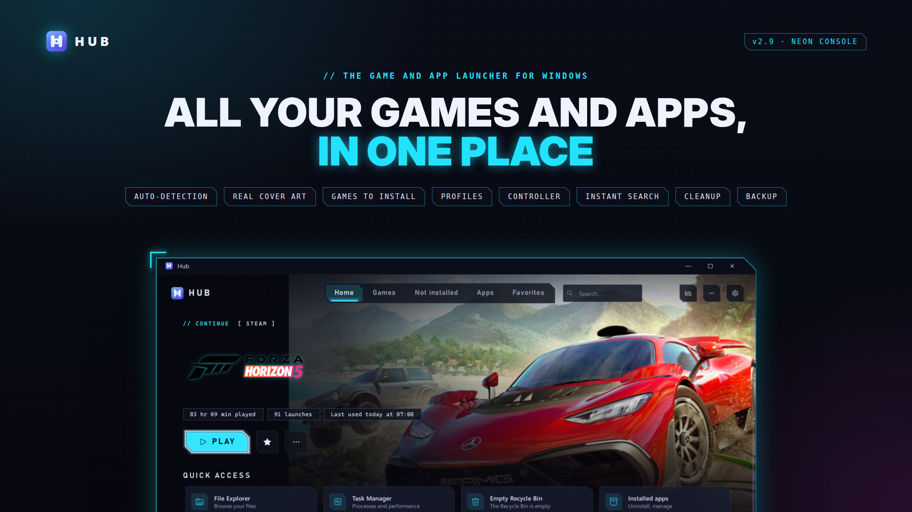

## Features

- **Console-style interface** with a neon look: your games with their real cover art, the last one you played
  front and center with its official artwork and a “Play” button.
- **Automatic detection** of installed apps: Start menu, Microsoft Store, Steam, Epic Games, GOG,
  Ubisoft Connect, Battle.net, EA app, Riot, Rockstar Games, Heroic, Playnite, and programs without a shortcut
  on any drive.
- **Cover art for all your games**: Steam's own, and for other launchers, the artwork from your Epic library or
  the Steam store, kept on your PC.
- **Games to install**: a separate tab for the games in your Steam, Epic Games, GOG Galaxy and Ubisoft Connect
  libraries that aren't installed, plus Battle.net and Rockstar games already played on this PC. Search finds
  them too, and one click opens their installation.
- **Free games from Epic Games**: this week's free game and the next one on the Home page, with a notification
  each time a new game is given away.
- **Steam playtime** imported automatically: the right game is featured from the very first launch.
- **Xbox controller**: the Hub works entirely with a controller, like a console.
- **Instant search**: initials, typos, calculator, Windows settings, web search.
- **Home page** with quick access to File Explorer, Task Manager, the Recycle Bin and installed apps.
- **Launch profiles**: several apps opened in a single click, in the order you choose (for example OBS,
  Discord and Spotify for a stream).
- **Statistics** of the time actually spent in each game and app (data stays on your PC), and a
  **weekly recap** every Sunday evening: playtime and most-played games.
- **Accent color** of your choice (neon cyan, magenta, ember, amethyst, mint, cover art color or Windows
  accent); favorites, categories, hidden apps.
- **Uninstall** a game or app with a right-click, and **Cleanup**: reclaim the space left by uninstalled games
  (folders moved to the Recycle Bin) and put away broken Start menu shortcuts.
- **Backup** of your settings, favorites, profiles and statistics in a .zip file, to restore after reinstalling
  Windows or on another PC.
- **Tidy up desktop**: shortcuts for the apps the Hub found leave the desktop, kept in a backup and put back in
  one click.
- **Global shortcut**, notification area icon, start with Windows and **automatic updates**, with what's new
  shown after each update.
- **English or French**, based on your Windows language.

## Screenshots

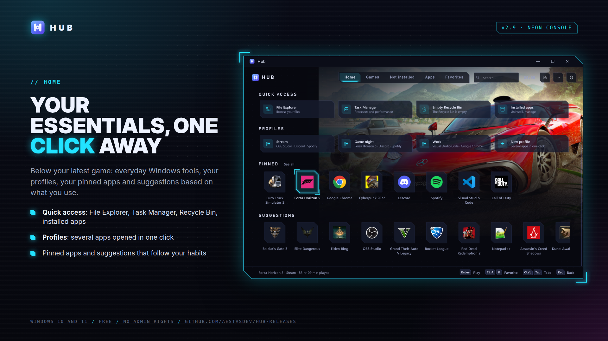
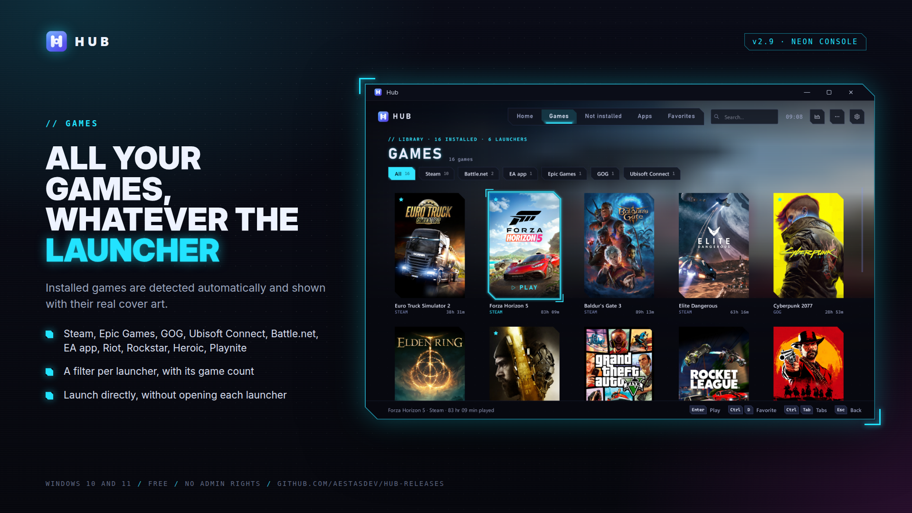
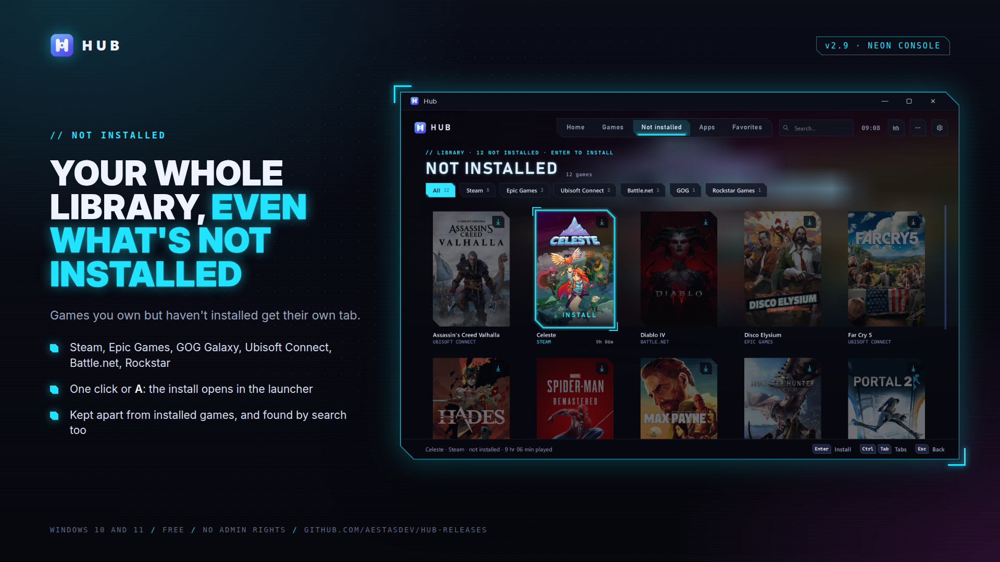
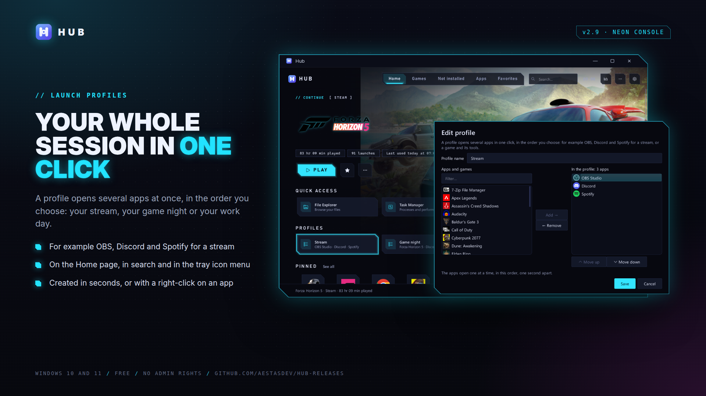
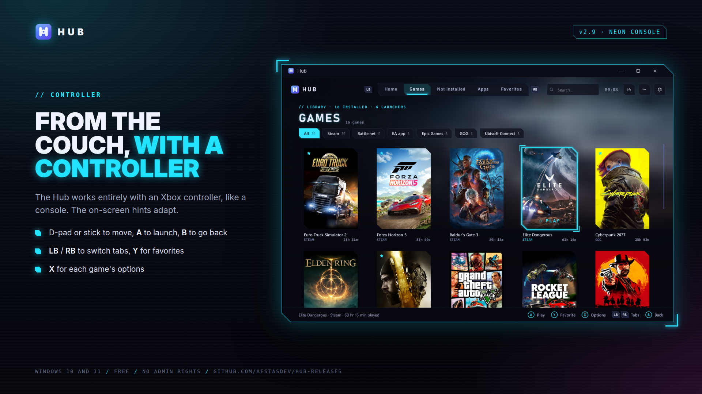
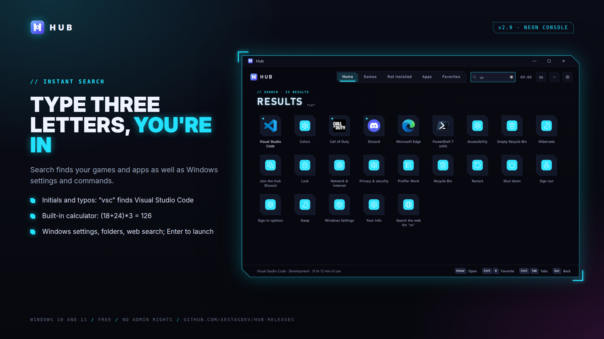
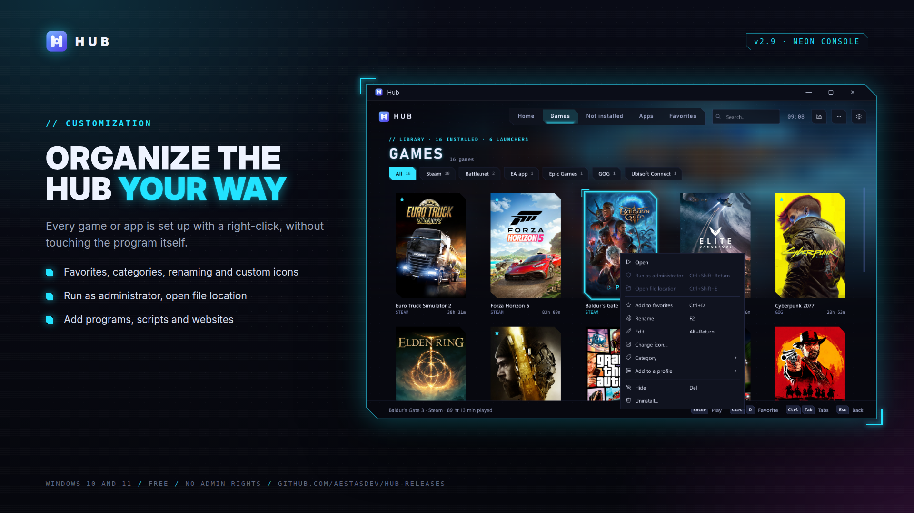
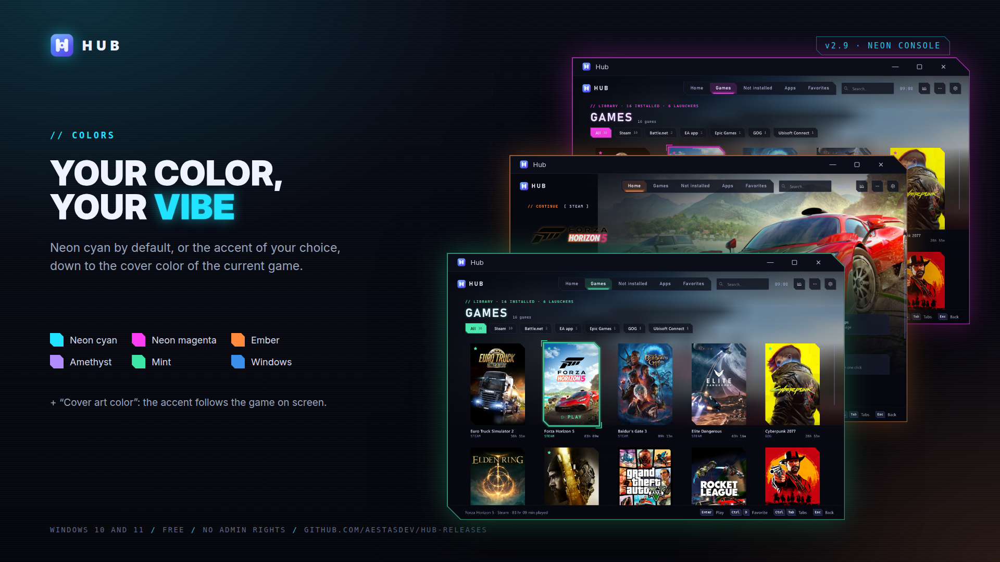
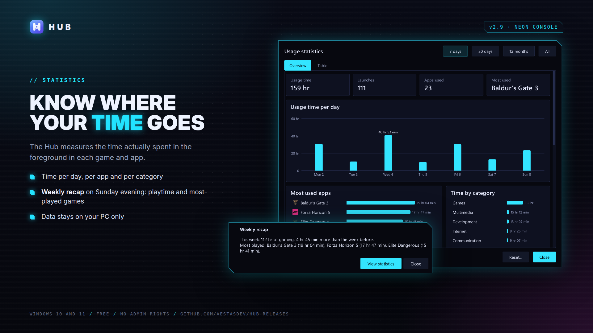
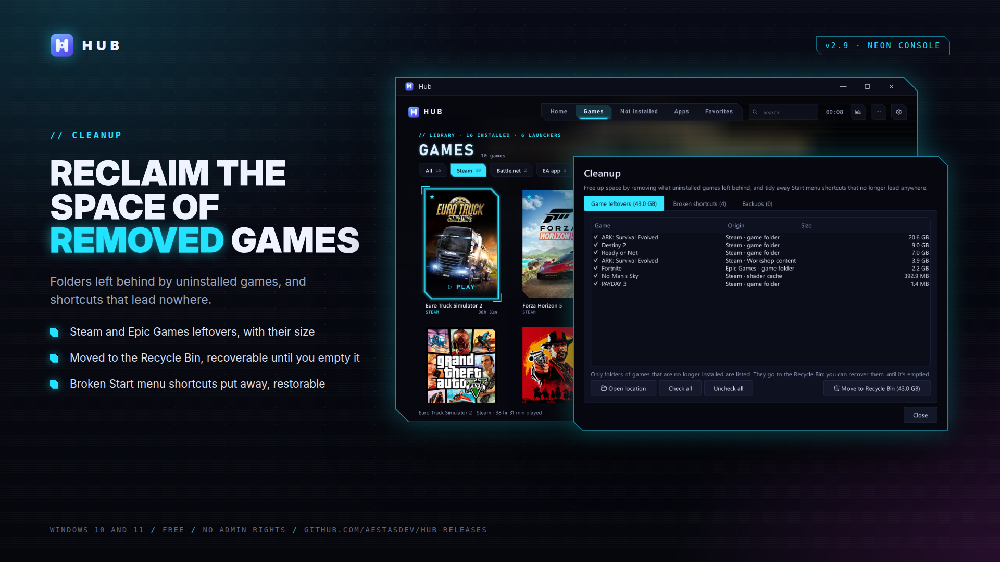
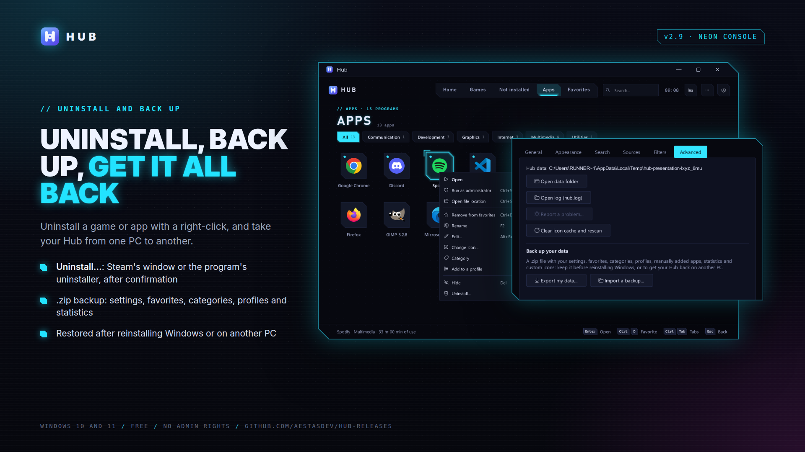
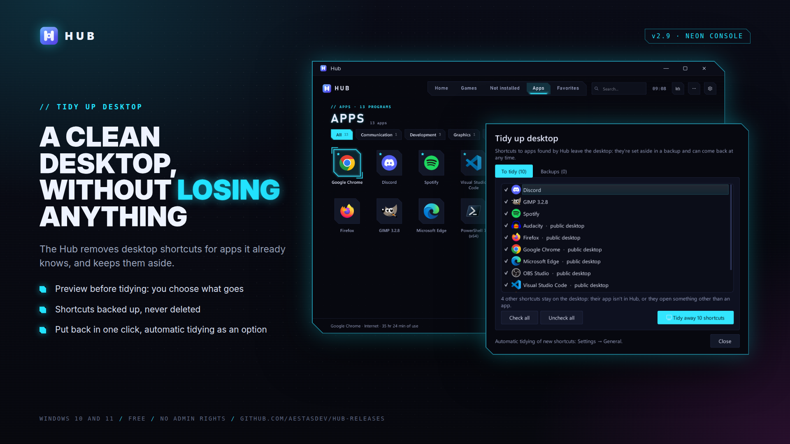
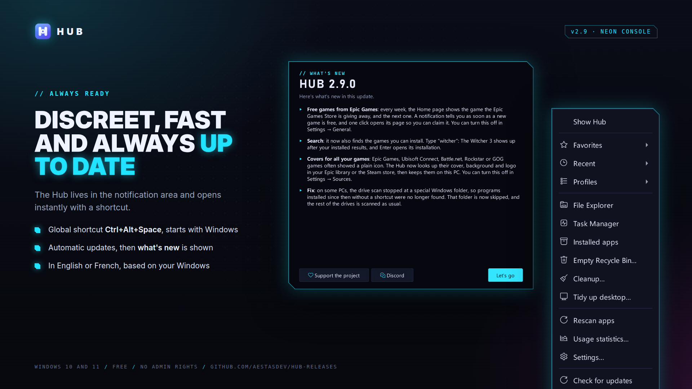

## Installation

1. Download `Hub-Setup-X.Y.Z.exe` from the [latest release](https://github.com/AestasDev/HUB-releases/releases/latest).
2. Run it: it installs for your user account only, **no administrator rights needed**.
3. Once installed, the Hub updates itself from this repository.

The installer is not signed, so Windows SmartScreen may show a warning (“More info” → “Run anyway”).

This repository only holds the published releases; the source code is private.

## Community

- **Discord**: [discord.gg/bhseMPZqn8](https://discord.gg/bhseMPZqn8), to ask questions, suggest ideas and
  follow new releases.
- **Found a bug?** In the Hub, “More options” menu → “Report a problem…”: the report is already prepared.
  You can also open one in the [Issues](https://github.com/AestasDev/HUB-releases/issues) tab.
- **Support the project**: the Hub is free. If you like it, you can support its development on
  [Patreon](https://www.patreon.com/AestasFR).
