

  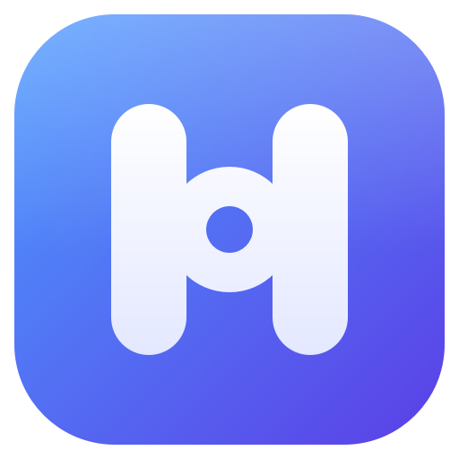

<h1 align="center">Hub</h1>

  <b>Toutes vos applications et vos jeux, au même endroit.</b> 
  Un lanceur rapide et élégant pour Windows 10 et 11.

  <a href="https://github.com/AestasDev/HUB-releases/releases/latest"><b>⬇ Télécharger la dernière version</b></a>
  &nbsp;·&nbsp;
  <a href="https://discord.gg/bhseMPZqn8"><b>💬 Rejoindre le Discord</b></a>

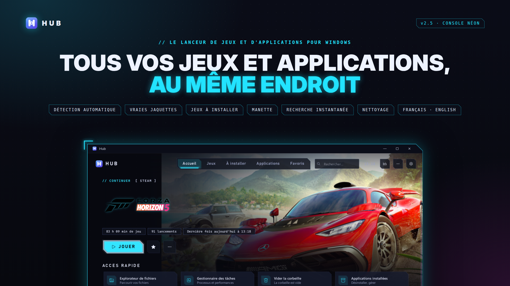

## Fonctionnalités

- **Interface façon console**, style néon : vos jeux avec leurs vraies jaquettes, le dernier joué en grand
  avec son illustration officielle et un bouton « Jouer ».
- **Détection automatique** des applications installées : menu Démarrer, Microsoft Store, Steam, Epic Games,
  GOG, Ubisoft Connect, Battle.net, EA app, Riot, Heroic, Playnite, et les programmes sans raccourci
  présents sur tous les disques.
- **Jeux à installer** : un onglet à part pour les jeux de vos bibliothèques Steam et Epic Games qui ne sont
  pas installés, avec leur jaquette ; un clic ouvre leur installation.
- **Temps de jeu Steam** repris automatiquement : le bon jeu est mis en avant dès le premier lancement.
- **Manette Xbox** : le Hub se pilote entièrement à la manette, comme une console.
- **Recherche instantanée** : initiales, fautes de frappe, calculatrice, paramètres Windows, recherche web.
- **Accueil** avec accès rapide à l'Explorateur, au Gestionnaire des tâches, à la corbeille et aux
  applications installées.
- **Profils de lancement** : plusieurs applications ouvertes d'un seul clic, dans l'ordre choisi (par exemple
  OBS, Discord et Spotify pour un live).
- **Statistiques** du temps réellement passé dans chaque jeu et application (données conservées sur votre PC),
  et un **bilan de la semaine** chaque dimanche soir : temps de jeu et jeux les plus joués.
- **Couleur d'accent** au choix (néon cyan, magenta, braise, améthyste, menthe, couleur de la jaquette ou de
  Windows) ; favoris, catégories, applications masquées.
- **Désinstaller** un jeu ou une application d'un clic droit, et **Nettoyage** : récupérez la place laissée par
  les jeux désinstallés (dossiers mis à la corbeille) et rangez les raccourcis cassés du menu Démarrer.
- **Sauvegarde** de vos réglages, favoris, profils et statistiques dans un fichier .zip, à réimporter après une
  réinstallation de Windows ou sur un autre PC.
- **Ranger le bureau** : les raccourcis des applications trouvées quittent le bureau, gardés en sauvegarde
  et remis en place en un clic.
- **Raccourci global**, icône de notification, démarrage avec Windows et **mises à jour automatiques**, avec
  les nouveautés présentées après chaque mise à jour.
- **Français ou anglais**, selon la langue de Windows (Hub is also available in English).

## Aperçu

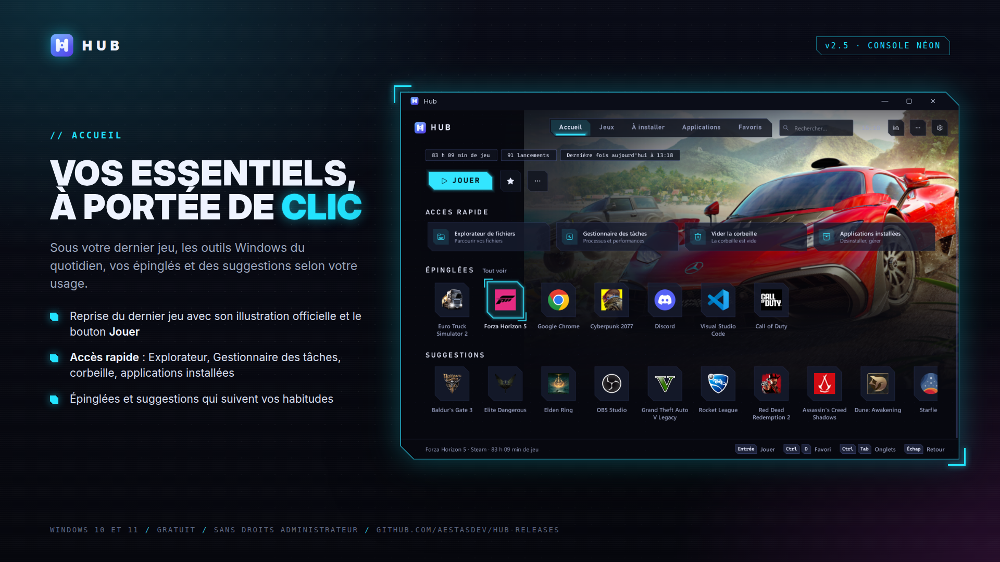
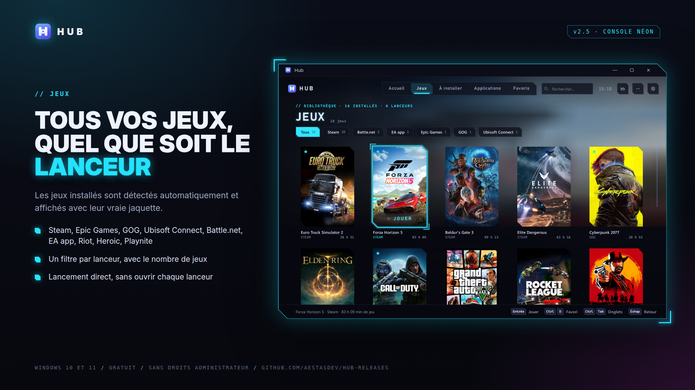
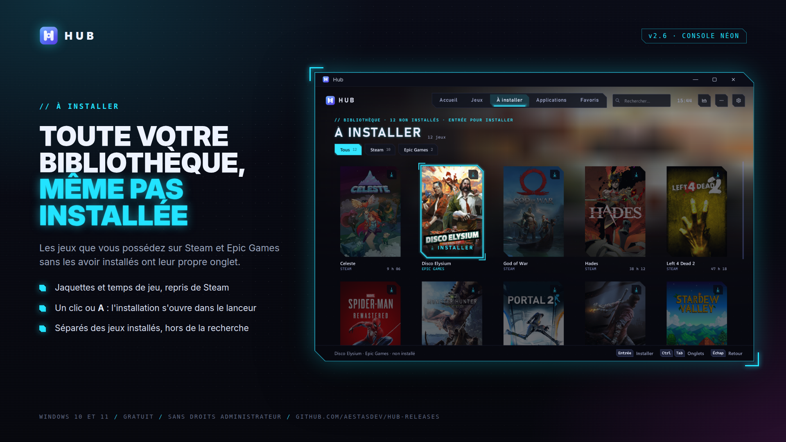
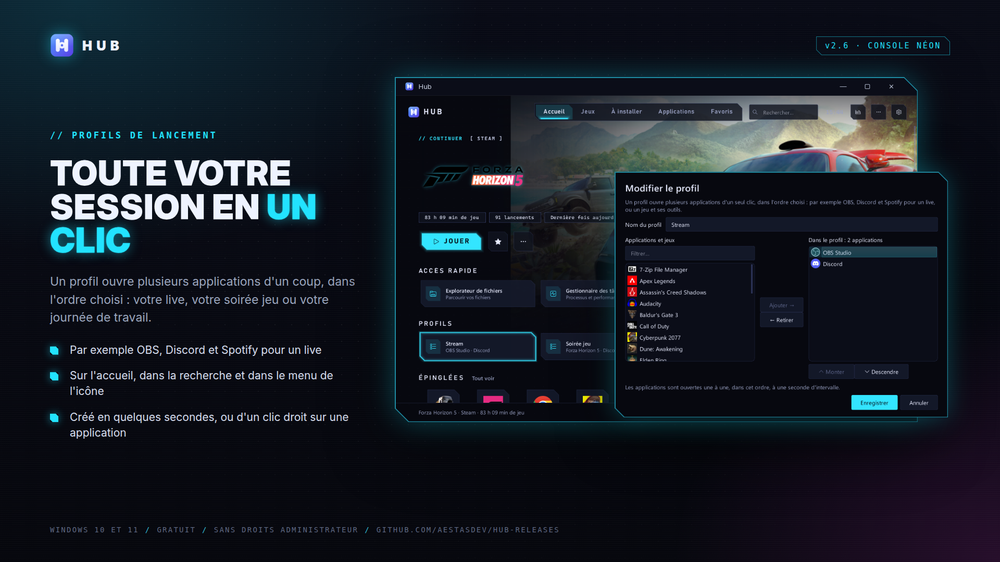
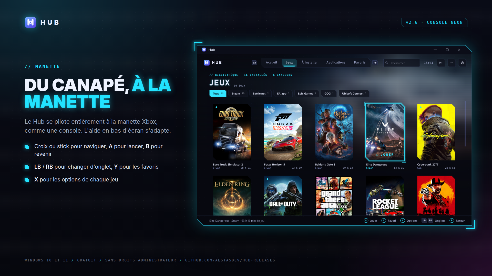
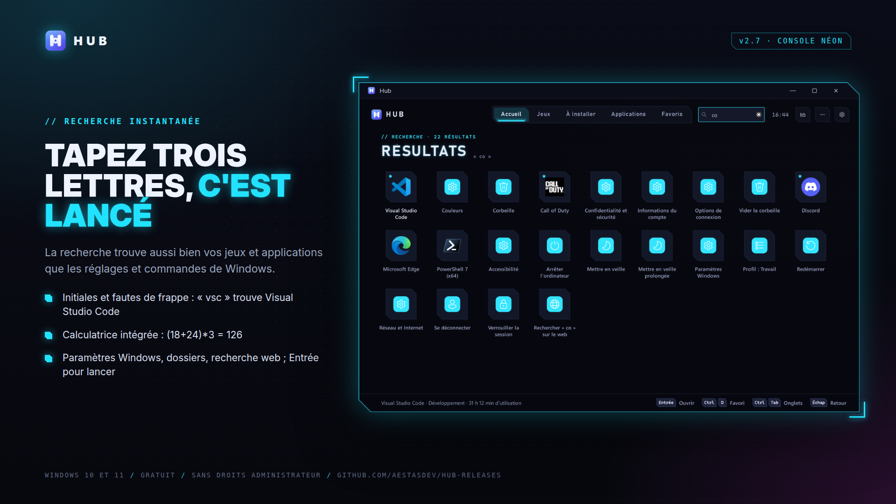
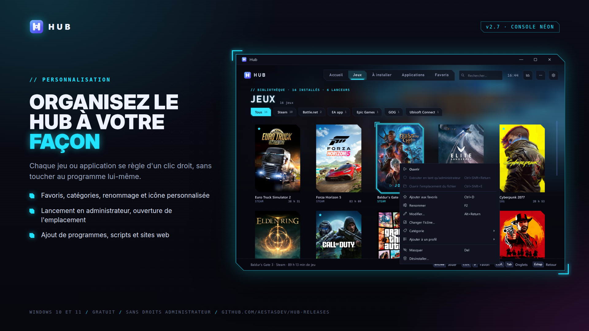
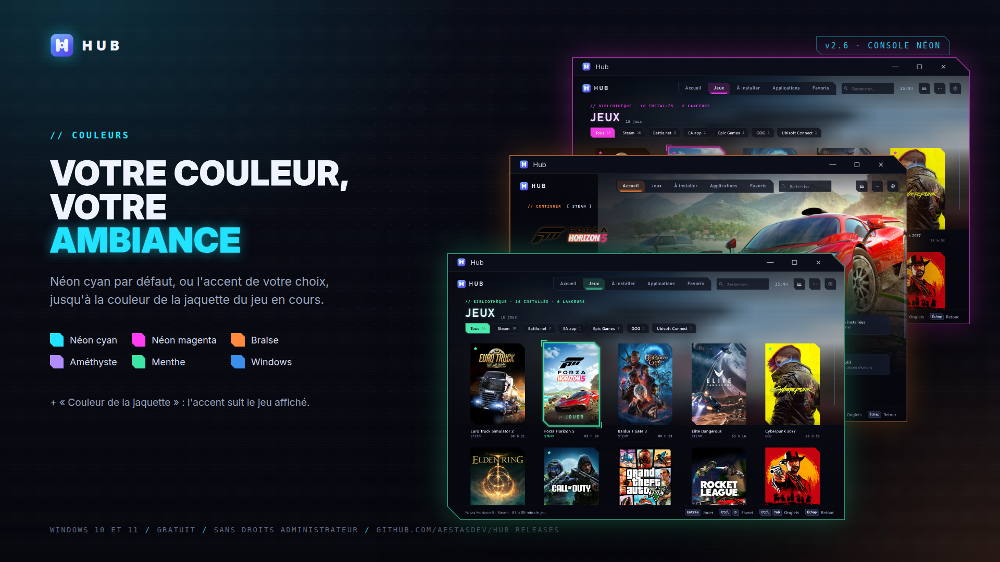
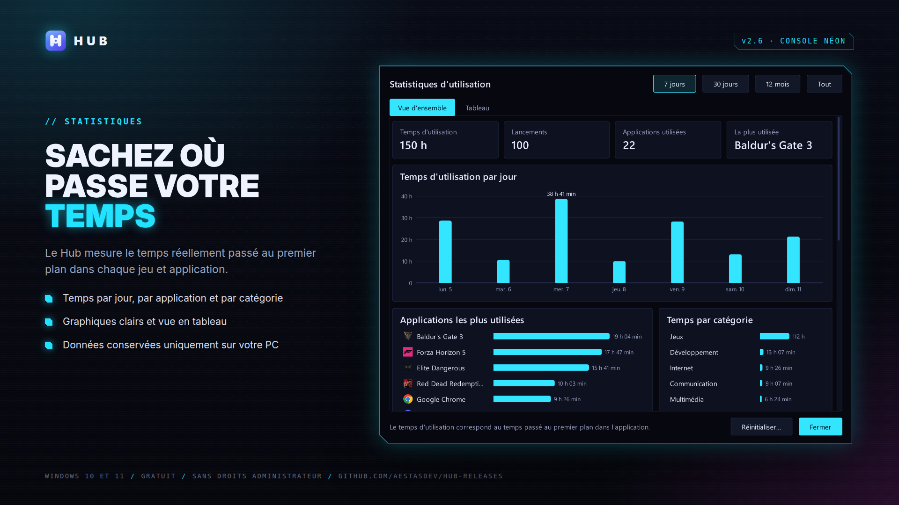
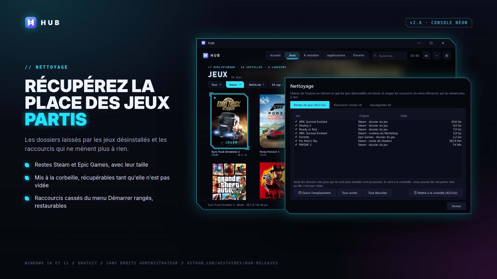
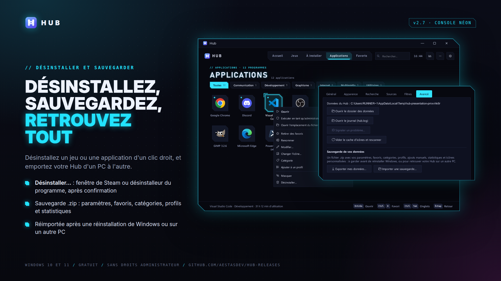
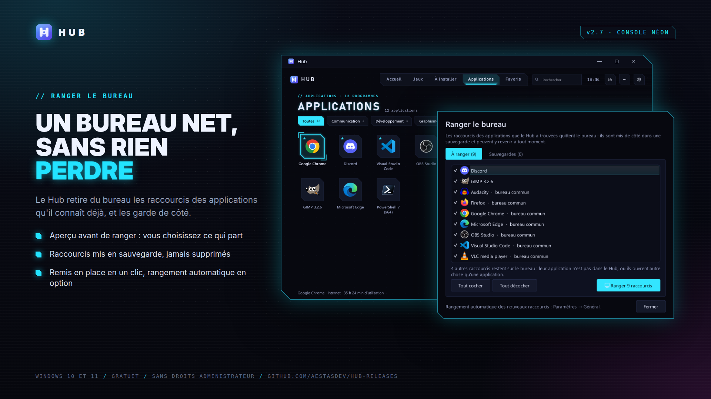
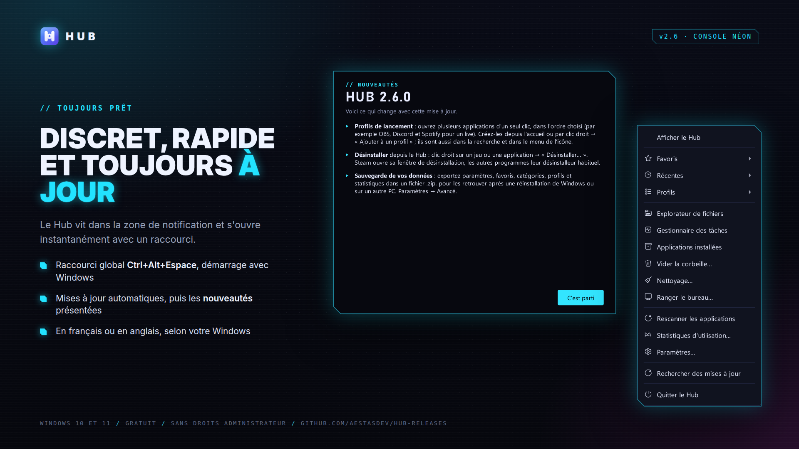

## Installation

1. Téléchargez `Hub-Setup-X.Y.Z.exe` depuis la [dernière version](https://github.com/AestasDev/HUB-releases/releases/latest).
2. Lancez-le : l'installation se fait par utilisateur, **sans droits administrateur**.
3. Une fois installé, le Hub se met à jour tout seul à partir de ce dépôt.

L'exécutable n'est pas signé : Windows SmartScreen peut afficher un avertissement
(« Informations complémentaires » → « Exécuter quand même »).

Ce dépôt ne contient que les versions publiées ; le code source est privé.

## Communauté

- **Discord** : [discord.gg/bhseMPZqn8](https://discord.gg/bhseMPZqn8), pour poser vos questions, proposer des idées
  et suivre les nouvelles versions.
- **Un bug ?** Dans le Hub, menu « Plus d'options » → « Signaler un problème… » : le rapport est déjà préparé.
  Vous pouvez aussi ouvrir un rapport dans l'onglet [Issues](https://github.com/AestasDev/HUB-releases/issues).
